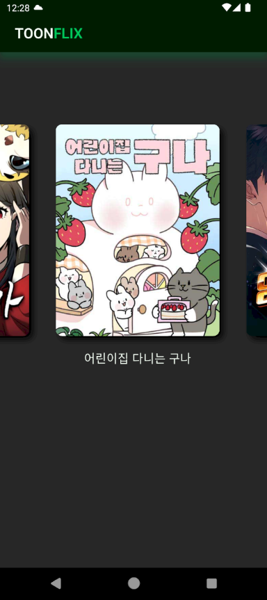
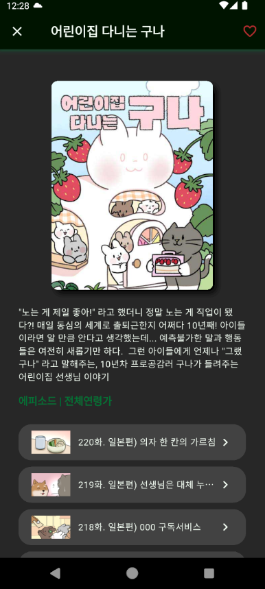
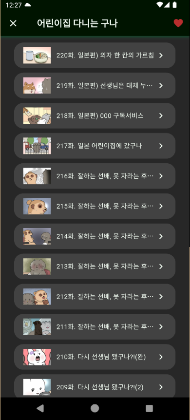

# Toonflix

오늘의 네이버 웹툰를 조회하고 즐겨찾기 기능을 제공하는 Flutter 기반 모바일 앱입니다.

노마드코더의 [Flutter로 웹툰 앱 만들기](https://nomadcoders.co/flutter-for-beginners/lobby) 강의를 기반으로 제작했으며, Flutter와 Dart를 학습하고 실제 앱 개발 과정을 경험하기 위해 진행한 프로젝트입니다.

## 주요 기능

- **웹툰 목록 조회** : 노마드코더 API를 통해 오늘의 네이버 웹툰 목록 데이터 가져오기
- **웹툰 상세 정보** : 웹툰의 제목, 장르, 시청 연령 소개 및 상세 내용 표시
- **회차 목록 조회** : 선택한 웹툰의 에피소드 목록 표시
- **화면 전환 애니메이션** : Hero 위젯을 활용한 이미지 전환 효과
- **외부 링크 연결** : 웹툰 및 에피소드 페이지로 이동
- 웹툰 즐겨찾기 : SharedPreferences를 활용한 웹툰 즐겨찾기 설정

## 화면 디자인

  
  
  

## 기술 스택

| 구분              | 기술                 |
| --------------- | ------------------ |
| Language        | Dart               |
| Framework       | Flutter            |
| API             | 노마드 코더 API         |
| IDE             | Visual Studio Code |
| Version Control | Git & GitHub       |

## 학습 내용

- Flutter의 기본 구조 및 Widget 개념 이해
- StatelessWidget과 StatefulWidget의 차이 및 활용
- setState를 이용한 상태 관리
- Future와 비동기 프로그래밍 이해
- API 통신 및 JSON 데이터 파싱
- FutureBuilder를 활용한 비동기 데이터 처리
- ListView를 이용한 목록 구현
- 재사용 가능한 Custom Widget 구성
- Hero 위젯을 활용한 화면 전환 애니메이션
- 화면 간 데이터 전달 및 페이지 이동
- SharedPrefereces를 이용한 앱 내 데이터 저장 및 활용

## 프로젝트 목표

Flutter와 Dart의 기본 개념을 익히고, API를 활용한 데이터 처리부터 UI 구성, 화면 전환 및 비동기 프로그래밍까지 모바일 앱 개발의 전반적인 과정을 경험하는 것을 목표로 합니다.

**Reference**

- [Nomad Coders - Flutter for Beginners](https://nomadcoders.co/flutter-for-beginners/lobby)
